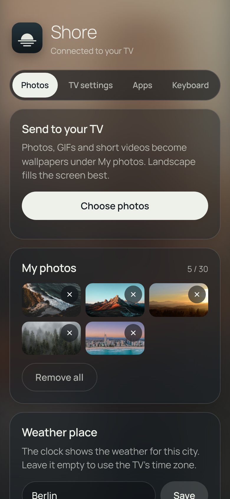
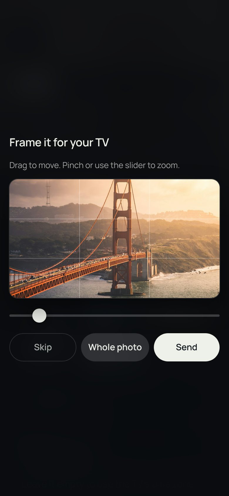
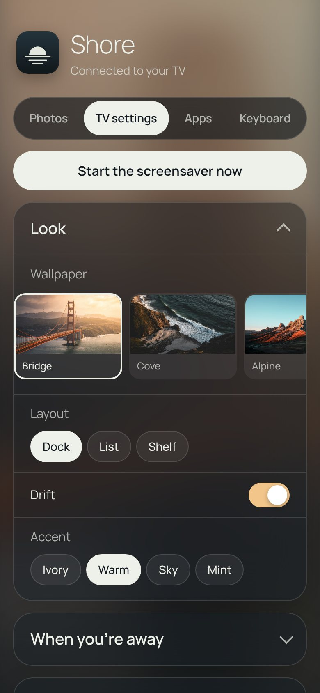
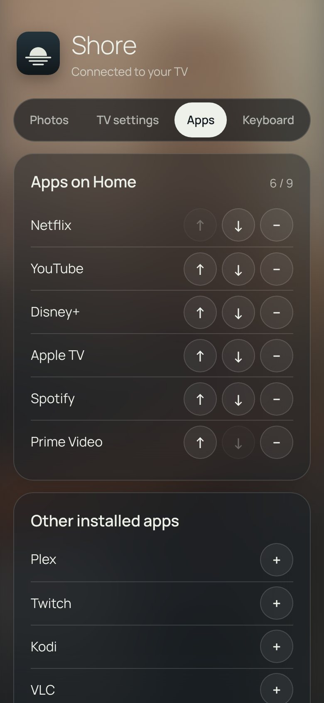

<div align="center">


# Shore

**A plainer home screen for Google TV.**<br>Your apps, your HDMI devices and a photo you chose, with the time, the weather and a headline in the corner.

[Website](https://taynotfound.github.io/shore/) · [Download](https://github.com/taynotfound/shore/releases/latest) · [Wiki](https://github.com/taynotfound/shore/wiki) · [Install](#install) · [Discord](https://discord.gg/z6C4Mj9VPK)

[](https://ko-fi.com/taygotkofi) [](https://github.com/sponsors/taynotfound) [](https://discord.gg/z6C4Mj9VPK)


</div>

Shore is a free, open-source launcher for **Android TV and Google TV**. It shows your apps, the devices plugged into HDMI and a photo you chose, with the clock, the weather and a headline on top. While music plays it opens the song full screen, with synced lyrics. Hold Home and you are back in Google TV.

It is a fork of [Nathan Clark's CleanFrame](https://github.com/nthnclrk/CleanFrame). The interface is the original HTML/CSS app; a small Java shell runs it full screen and connects it to the TV. Shore is built and tested on a **TCL 55C6KS**, and people run it on [other TVs](https://github.com/taynotfound/shore/wiki/Verified-devices) too.

> [!NOTE]
> **Unofficial.** Not affiliated with TCL, Google or any streaming service. Everything is reversible, and each step says how.

## Install

You need a computer on the same Wi-Fi with [Android platform tools](https://developer.android.com/tools/releases/platform-tools) (`adb`), once. Shore installs next to Google TV and removes nothing.

1. On the TV, turn on **developer options** (*Settings › System › About*, press OK on *Android TV OS build* seven times) and **USB debugging**.
2. Connect and install the APK from the [latest release](https://github.com/taynotfound/shore/releases/latest):

   ```sh
   adb connect <tv-ip>:5555
   adb install -r Shore.apk
   ```
3. Turn on *Settings › System › Accessibility › Shore Home button* so Home opens Shore. On TCL sets, also allow auto start.

The [Installation](https://github.com/taynotfound/shore/wiki/Installation) page has every step, including Android 14's wireless debugging and the [TCL auto start fix](https://github.com/taynotfound/shore/wiki/Home-button#tcl-tvs-allow-auto-start). After this you never need the computer again: Shore [updates itself](https://github.com/taynotfound/shore/wiki/Updates).

## What it does

| | |
| --- | --- |
| **Home** | Dock, List and Shelf layouts, up to nine apps in your order, recently used apps, your own icons, Continue watching. [More](https://github.com/taynotfound/shore/wiki/Home-screen) |
| **HDMI inputs** | A console or set-top box gets a tile when it is switched on, named over HDMI-CEC. [More](https://github.com/taynotfound/shore/wiki/HDMI-inputs) |
| **Search** | Apps, inputs and Settings pages, typed with the remote or on your phone. [More](https://github.com/taynotfound/shore/wiki/Search-and-settings) |
| **Pictures** | 15 bundled photos, online and animated wallpapers, your own photos, a different photo for each part of the day. [More](https://github.com/taynotfound/shore/wiki/Wallpapers) |
| **Under the clock** | Weather, headlines, your next calendar event, what is playing, optional widgets. [More](https://github.com/taynotfound/shore/wiki/Under-the-clock) |
| **Music view** | The cover, controls and synced lyrics that light up word by word. [More](https://github.com/taynotfound/shore/wiki/Music-view) |
| **When you're away** | Shore's own screensaver, night mode and a sleep timer. [More](https://github.com/taynotfound/shore/wiki/Screensaver-night-and-sleep) |
| **Control** | Any remote button can do something else. A parental lock and daily screen time limits. [More](https://github.com/taynotfound/shore/wiki/Remote-buttons) |
| **Phone companion** | A web app on your phone, served by the TV: photos, settings, apps, keyboard, backups. [More](https://github.com/taynotfound/shore/wiki/Phone-companion) |
| **Add-ons** | Off until you switch them on: Home Assistant, Pi-hole and AdGuard, weather effects, headlines, widgets. [More](https://github.com/taynotfound/shore/wiki/Add-ons) |
| **Performance** | *Auto*, *High end*, *Balanced* or *Potato*: Shore keeps what your TV can draw smoothly. [More](https://github.com/taynotfound/shore/wiki/Performance) |
| **Languages** | English, German, French, Spanish, Dutch, Polish, Ukrainian, Italian and Turkish. |

<table>
<tr>
<td width="25%"></td>
<td width="25%"></td>
<td width="25%"></td>
<td width="25%"></td>
</tr>
<tr><td colspan="4"><sub><b>The phone companion</b>: photos, TV settings and apps from your phone, over your home Wi-Fi. Pictures of the real page with invented data.</sub></td></tr>
</table>

## Verified devices

Most Google TV and Android TV sets should work. These have been run:

| Device | System | Status |
| --- | --- | --- |
| TCL 55C6KS | Android TV 12 (Google TV) | Reference TV: everything is built and checked here |
| TCL 65C7K | Google TV | Reported working |
| CHiQ L32QM8G | Android 14 | Reported working |
| Hisense A6N series | Android TV 12, 2 GB RAM | Reported working, Home Assistant add-on tested |

The wiki's [Verified devices](https://github.com/taynotfound/shore/wiki/Verified-devices) page has the details, and a [TV report](https://github.com/taynotfound/shore/issues/new?template=3-tv-report.yml) adds yours.

## Documentation

The **[wiki](https://github.com/taynotfound/shore/wiki)** has a page for every feature, plus [Troubleshooting](https://github.com/taynotfound/shore/wiki/Troubleshooting).

## Build from source

```sh
git clone https://github.com/taynotfound/shore.git && cd shore
echo "sdk.dir=$HOME/Android/Sdk" > android/local.properties
gradle -p android assembleRelease
```

Needs JDK 17 and the Android SDK (platform 35). Release APKs carry no API keys, so Unsplash, Pexels and Klipy wallpapers and Top Shelf recommendations need a build with your own. The [Build from source](https://github.com/taynotfound/shore/wiki/Build-from-source) page covers keys, GitHub Actions and the browser preview (`npm ci && npm run dev:public`). Read [CONTRIBUTING.md](CONTRIBUTING.md) before opening a pull request, and [`docs/`](docs/README.md) for developer notes.

## Support

Questions, bugs or a TV to report: [Discord](https://discord.gg/z6C4Mj9VPK), usually the fastest way to reach me. Shore is free. If you'd like to support it: [Ko-fi](https://ko-fi.com/taygotkofi) · [GitHub Sponsors](https://github.com/sponsors/taynotfound)

## Credits and licences

MIT. Shore is a fork of CleanFrame by Nathan Clark and keeps its [licence](LICENSE) and [third-party notices](THIRD_PARTY_NOTICES.md). The Home Assistant add-on was made by [mozthewah](https://github.com/mozthewah). Photos, logos, fonts, weather, lyrics and recommendations come from other people under their own terms; the full list is on the wiki's [Credits and licences](https://github.com/taynotfound/shore/wiki/Credits-and-licences) page.
