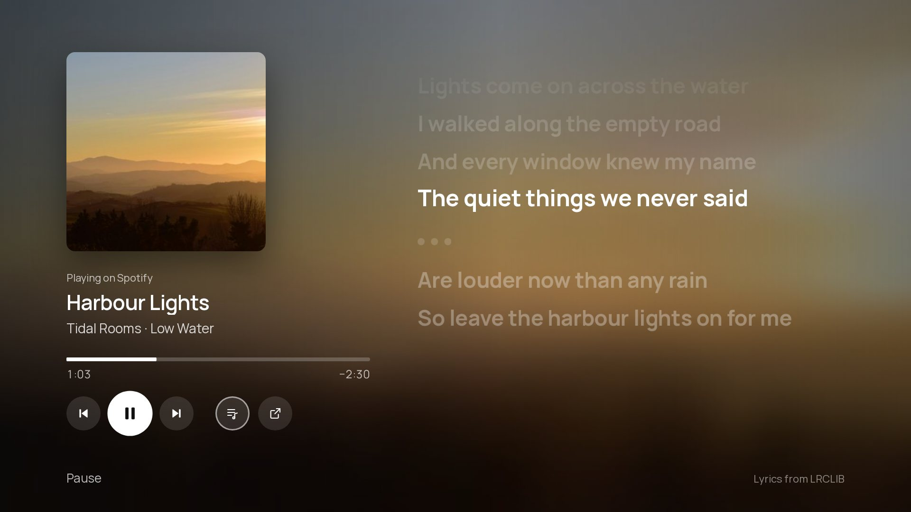

<div align="center">


# Shore

A home screen for Google TV that shows your apps, your HDMI devices and a photo you chose, with the time, the weather and a headline in the corner.

While music plays, it opens the song full screen with synced lyrics that light up word by word, and an optional pulse on the beat.

[Website](https://taynotfound.github.io/shore/) · [Install](#install) · [Features](#features) · [Music view](#music-view) · [Phone companion](#phone-companion) · [Wallpapers](#online-and-animated-wallpapers) · [Top Shelf](#top-shelf) · [Build](#build-from-source)

## For Faster response times, join my [Discord](https://discord.gg/z6C4Mj9VPK)

[](https://ko-fi.com/taygotkofi) [](https://github.com/sponsors/taynotfound) [](https://discord.gg/z6C4Mj9VPK)


</div>

Shore (formerly CleanFrame-TCL) brings [Nathan Clark's CleanFrame](https://github.com/nthnclrk/CleanFrame), originally made for Samsung The Frame, to **Android TV and Google TV**. It is tuned and tested on a **TCL 55C6KS** (55" Mini LED, 4K, Android TV 12) and also reported running on a TCL 65C7K, a CHiQ L32QM8G (Android 14) and a Hisense A6N (Android TV 12). See [Tested TVs](#tested-tvs). The interface is the original HTML/CSS app; a small Java shell runs it full screen and connects it to the TV.

> [!NOTE]
> **Unofficial.** Not affiliated with TCL, Google, Samsung or any streaming service. Everything here is reversible, and each step says how.

## Features


### Home
- Three layouts. *Dock* and *List* draw every app logo the same way: Shore's own logos in colour or in one colour, or the icons from an installed icon pack (for example one made for Projectivy Launcher). *Shelf* shows each app's own banner, with a [Top Shelf](#top-shelf) above it.
- Shore finds your installed apps. Pick up to nine for Home and put them in order.
- *Recently used*: in Dock, up to three apps you opened lately but haven't put on Home follow Home's apps, after a thin line. Turn it off in *Settings › Home screen*.
- Your own icon for each app: hold OK on an app and choose *Icon*, or go to *Settings › Home screen › App icons › Per app*. Pick one of Shore's icons, the app's own icon or a one-colour version.
- While something plays, a ♪ *Music* button joins the top-right row on Home and opens the [music view](#music-view): the cover, a progress bar you can seek, *Previous*, *Pause/Play*, *Next*, and synced lyrics. After a pause it stays for 10 minutes so you can resume. Needs Notification access, like Now playing.
- *Continue watching*: in Dock, a row under the apps with what you were watching in apps that share it with Android (Twitch, Apple TV and others); in Shelf, each app's own items come first in its Top Shelf row. Allow it when Android asks.
- Hold OK on an app on Home for *Open*, *Move*, *Remove*, *Icon* or *App info*. A normal press still opens the app; Move and Remove go through *Apps on Home*, so they can be undone.
- HDMI devices appear when they are switched on, named over HDMI-CEC ("PlayStation 5" instead of "HDMI 1"). Switch on a console or set-top box and its tile shows up; switch it off and it disappears. Show inputs first on Home or in their own row, and Shore offers to switch when one turns on. Inputs you never use can be hidden.
- The launcher follows the TV's system language (*Settings › System › Language*). German, French, Spanish, Dutch, Polish, Ukrainian, Italian and Turkish are included; anything else falls back to English.

### The picture
- 15 bundled photographs with pre-rendered glass, plus online wallpapers from NASA, Bing, Wikimedia, Picsum and Unsplash.
- Animated wallpapers: bundled seamless loops, Pexels video loops and Klipy GIFs.
- [Phone companion](#phone-companion): scan a QR code and send photos, GIFs and short videos to the TV, from a web app styled like the launcher.
- Drift: a slow Ken Burns zoom where the photo and its glass move together.
- Rotation: a new picture each time Home opens, every 5, 15 or 60 minutes, once a day, or *By time of day*: morning, day, evening and night each get their own photo. Pin one to each part, or leave it on *Automatic* for a darker photo in the evening and at night and a brighter one by day, different every day.
- Night mode dims everything on a timer (21–07, 22–06, 23–07) or all the time, in three strengths. With *Calmer photos at night*, rotation sticks to dark photos while it is on, and a bright wallpaper gives way to a dark one when night begins.

### Text, clock and info
- Eight open-licence fonts, with text weight and app-name size.
- Clock: 12- or 24-hour, optional date, four sizes and weights.
- [Under the clock](#under-the-clock-weather-music-and-news): the current weather in °C or °F (Open-Meteo, no key), what's playing in Spotify, YouTube or any other app, and news headlines from Google News, an outlet you pick or your own feed.
- Hide controls when idle: after 1 or 5 minutes only the picture and clock stay.
- Calendar: the next event from your calendar's iCal address (Google Calendar, iCloud, Outlook and others share one), set in the [phone companion](#phone-companion). Repeating events are understood.
- Focus style and glass materials.

### On the TV
- The Home button opens Shore. Hold Home for the original Google TV Home.
- When something stops working (the Home button service after an update, notification access, a wallpaper source) or an update is waiting, a small dot appears on *Settings*. *Settings › Google TV › Setup and health* says what.
- Reassign remote buttons such as the app shortcut keys or the TV button.
- Animations pause outside Home, so menus stay snappy.
- Sleep timer (*Settings › Night*): 30, 60, 90 or 120 minutes, then the TV switches off, even while another app is open. It needs the Shore Home button in Accessibility.
- Add-ons (*Settings › Add-ons*, off until you switch them on): **Home Assistant** (rooms, lights, thermostats and cameras on Home, and your door camera when the doorbell rings) and **Pi-hole and AdGuard** (today's blocked share under the clock, and a pause for 5, 30 or 60 minutes). Servers and passwords are typed on the phone and stay on the TV.
- Parental lock (*Settings › Google TV › Parental lock*): a four-digit PIN before chosen apps open, and before Settings, Apps on Home and Quick actions. Enter it with the arrows and OK or with number keys. *Screen time* on the same page gives an app a daily limit (30 minutes to 3 hours); it counts while the app is on screen and resets at midnight. When it runs out Shore comes back, and the PIN gives 30 more minutes. It needs the Home button service.
- Search (*All apps › Search*, or type a letter with a keyboard): apps, inputs and Settings pages.
- An optional, reversible debloat list for TCL's preinstalled extras.

| | |
| --- | --- |
|  |  |
|  |  |
|  |  |
|  |  |

<table>
<tr><th>Aurora</th><th>Dusk</th><th>Deep sea</th></tr>
<tr>
<td></td>
<td></td>
<td></td>
</tr>
</table>

<sub>Bundled animated loops. On the TV they play at 1080p behind the interface.</sub>

## Tested TVs

Shore is an ordinary Android TV app, so most Google TV and Android TV sets should work. These are confirmed by the maintainer or by people running it:

| TV | System | Chip, memory | Notes |
| --- | --- | --- | --- |
| TCL 55C6KS | Android TV 12 (Google TV) | MediaTek, 4K Mini LED | Reference TV: everything is built and checked here |
| TCL 65C7K | Google TV | | Reported working |
| CHiQ L32QM8G | Android 14 | | Reported working |
| Hisense A6N series ("SmartTV 4K", lushan-NF) | Android TV 12 (API 31) | MediaTek MT9676, 4× Cortex-A55 at 1.53 GHz (32-bit), Mali-G52, 2 GB RAM | Works with only ~360 MB free; the interface draws at 1080p and is scaled to 4K. Home Assistant add-on tested here. WebView Chrome 155 |

Running it on another TV? A [TV report](https://github.com/taynotfound/shore/issues/new?template=3-tv-report.yml) adds it to this list.

## Install

You need a computer on the same Wi-Fi with [Android platform tools](https://developer.android.com/tools/releases/platform-tools) (`adb`).

1. Enable developer options. On the TV, open *Settings › System › About*. Press OK on **Android TV OS build** seven times, until "You are now a developer" appears. Use the main profile; kids profiles hide this.
2. Turn on debugging in *Settings › System › Developer options › USB debugging*.
3. Connect, replacing `<tv-ip>` with the address from *Settings › Network*:

   ```sh
   adb connect <tv-ip>:5555
   ```

   The TV asks "Allow debugging?". Tick **Always allow from this computer** and press OK.
4. Install the APK from the [latest release](https://github.com/taynotfound/shore/releases/latest) or [build it](#build-from-source):

   ```sh
   adb install -r Shore.apk
   ```

Shore now appears in your apps. Open it once; it remembers everything on the TV. The first time, it offers a short setup: *Settings › Google TV › Setup and health* lists each step (Home button, what's playing, wallpaper sources, phone companion, updates) with a tick when it works, and OK opens the place that fixes it. Come back to it whenever something seems off, for example when the TV blocked the Home button service after a restart.

**Updating.** After the first install you don't need a computer again. *Settings › Google TV › Shore updates* checks the public releases (automatically every few hours, or on demand), downloads the new APK, checks that it is Shore, newer and signed with the same key, and opens Android's installer. Android asks you to confirm, and the first time it asks you to allow Shore to install apps. Settings and photos stay. Only release APKs update themselves: a copy you built yourself just tells you when a new version is out, so you can pull the latest source and rebuild it with your keys.

> [!NOTE]
> **Release APKs carry no API keys.** Each release is built from `main` (version `0.8.<commit count>`). Weather, NASA, Bing, Wikimedia and Picsum wallpapers, album art lookups and everything else work as they are. Unsplash, Pexels and Klipy wallpapers and Top Shelf recommendations need your own keys: [build from source](#build-from-source) with them in `android/local.properties`.

<details>
<summary>Android 14 builds with "Wireless debugging"</summary>

Open *Wireless debugging › Pair device with pairing code*, then run `adb pair <ip>:<pair-port> <code>` and `adb connect <ip>:<port>`. The pairing port is different from the connect port.

</details>

### Make the Home button open Shore

Google TV always sends Home to its own launcher and ignores the "default home app" setting. Shore includes a small accessibility service that catches the Home key instead, the same approach launchers like Projectivy use. Turn it on yourself:

**Settings › System › Accessibility › Shore Home button › On**

- Press Home to open Shore.
- Hold Home for about a second to open the original Google TV Home. *Settings › Google TV › Google TV Home* in Shore does the same.
- If Google TV Home appears by itself, for example after leaving an app, Shore takes over. It won't do that if you opened Google TV Home on purpose.

The service only sees remote keys and which app is in front. It never reads screen content. Turn the switch off to undo.

> [!IMPORTANT]
> **TCL TVs: allow auto start.** After a restart, TCL's boot manager refuses to start accessibility services of apps without its *auto start* permission. The switch then still shows *Enable* on, but the service shows *Off* and no button works. Shore's *Remote buttons* page says so when this happens. Allow Shore to auto start in TCL's **TV Guard** (permission manager), then switch *Shore Home button* off and on once.

### Reassign remote buttons

*Settings › Google TV › Remote buttons* (needs the accessibility service). Choose **Assign a button…**, press a button on the remote, then pick what it does:

- *Default*: what the TV normally does. This removes the assignment.
- *Shore Home*, *Do nothing* or *Screensaver* (Shore's own, see below).
- A connected HDMI input, or an app from your Home screen.

Assignments work everywhere, including inside other apps.

<details>
<summary>Limits</summary>

- Shore only sees buttons that reach Android's accessibility key filter. If the TV firmware handles a button first, the page says *No button arrived*.
- Navigation, OK, Back, Home, volume and power are never captured.
- Two buttons that send the same Android key code share one assignment.
- Not yet tested on the TCL RC833 remote itself.

</details>

### HDMI inputs

Inputs come from Android's TV Input Framework. A device that is **plugged in and switched on** gets a tile; standby or unplugged devices are hidden. OK switches the TV to that input, and inputs you rename in the TV settings keep their name. Otherwise a tile uses the name the device announces over HDMI-CEC, such as *PlayStation 5* or *Apple TV*. CEC must be on in the TV settings (TCL calls it *T-Link*); without it the port name, such as *HDMI 1*, is shown. Choose *Settings › Home screen › Inputs › First in Home* or *Own row*. When a device switches on while Home is showing (or the screensaver runs), Shore asks *PlayStation 5 is on · Switch / Stay*; OK switches to it, and the question goes away after 20 seconds. Turn this off with *Ask* in the same row.

Each input gets an icon from its name: a controller for *PlayStation* or *Xbox*, a box for *Sky Q*, a disc for a Blu-ray player, a speaker bar for a soundbar, and so on; unknown devices keep the HDMI plug. To change either, hold OK on the tile (*Rename*, *Icon*) or open *Settings › Inputs* and pick the input. *Name* offers common devices, and the phone companion's *Apps* tab takes any name you type.

### Language

Shore uses the TV's system language: German, French, Spanish, Dutch, Polish, Ukrainian, Italian and Turkish are built in, and anything else shows English. Change it in *Settings › System › Language* on the TV, then reopen Shore. Translations live in [`app/i18n/`](app/i18n/), one file per language keyed by the English text and loaded by [`app/i18n.js`](app/i18n.js); the phone companion keeps its own short list in `STR` in its `app.js`. In the browser preview, `?lang=de` picks a language.

### Settings

Shore's settings are two columns of short pages. **Look**: Wallpaper (background type, photo, sources, rotation, motion, calmer photos at night), Home screen, Apps on Home, Style (focus, material, accent, glass) and Text and icons. **When you're away**: Night (night mode, hours, dimming, hiding the controls when idle) and Screensaver. **Clock and info**: Clock, Weather, Music and News. **Shore**: Phone and Google TV (Home, TV settings, remote buttons, setup and updates). Up and Down move within a column, Left and Right cross to the other one. The phone companion lists the same groups.

### Music view



Press ♪ *Music* on Home while something plays.

- The cover, title, artist and album, with the music app's blurred cover behind them. A new song replaces everything on its own.
- A progress bar with the time played and left. Up selects it; Left and Right jump 10 seconds when the app allows seeking.
- *Previous*, *Pause/Play*, *Next*, and a button that opens the music app.
- Synced lyrics from [LRCLIB](https://lrclib.net), free and without an account. Lines ripple into place like Apple Music's, the line being sung grows, and its words light up in turn: exactly where LRCLIB has word timing, otherwise spread over the line. Shore only shows lyrics whose title, artist and length match the version playing, so a different edit or a cover shows none rather than the wrong words. Only the artist, title, album and length are sent.
- Beat pulse (off by default): the beat pushes the background and the cover out a little. Shore learns where each song keeps its beat, from 808s and kicks to snares, claps and hi-hats, and starts learning again when the song changes. It uses Android's Visualizer on the TV's own sound output, never the microphone, but Android still asks to allow audio recording. Only the bass level is read, about 20 times a second, and only while the music view is open.
- *Up next*: the next three songs, when the music app shares its queue (not every app does; Spotify on Google TV doesn't).
- *Translate lyrics* (off by default): each synced line gets a translation into the TV's language underneath. The lyric text is sent to Google Translate; songs already in that language stay as they are.
- While a song plays, the music view keeps the screen on and the screensaver away, like a video.
- *Settings › Music › Music view* turns lyrics, word by word, translation, Up next and the beat pulse on or off.

### Under the clock: weather, music and news

*Settings › Weather, Music and News.*

- Weather shows the temperature and sky, such as *12 °C Cloudy*, next to the date. It comes from [Open-Meteo](https://open-meteo.com), which needs no key or account. The place is the city of the TV's time zone (*Europe/Berlin* gives Berlin), or the place you type in the [phone companion](#phone-companion). Choose **°C or °F** under *Temperature*. Shore refreshes the weather every 30 minutes, and it is off until you turn it on.
- Weather effects (*Weather › Details*) draw the current weather over the photo: rain, a light drizzle, snow, drifting fog, or a storm with the odd flash of lightning. Clear and cloudy skies leave the photo alone. They need Weather on and a Photo background, follow night dimming, and pause whenever Home is not on screen. The layers are pre-drawn and only slide, so the TV never redraws or blurs the photo for them.
- Headlines (*Settings › News*) show one news headline under the clock and on the screensaver, with its source, changing every 20 seconds. Choose the **source**: Google News top stories for the TV's language and country, a news outlet for the TV's language (for example tagesschau, DER SPIEGEL, ZEIT ONLINE and DW in German, ANSA and la Repubblica in Italian, BBC News Türkçe and DW Türkçe in Turkish, BBC News, The Guardian, NPR and Al Jazeera in English; BBC News is offered in every language), or **Your own feed**, any RSS or Atom feed you save under *News feed* in the [phone companion](#phone-companion). Saving a feed there switches to it. The TV fetches the feed at most every 30 minutes and keeps only titles, sources and times; nothing else is sent. Off until you turn it on.
- Now playing shows a small moving level meter and *Title · Artist — App* while something plays in another app, for example Spotify in the background. Android only shares media sessions with apps that have notification access. So allow **Shore Now playing** under *Settings › Apps › Special app access › Notification access*; the Music page has a shortcut. Shore reads only the active media session and ignores notifications themselves. The level meter is decoration and does not follow the music; only the optional beat pulse in the music view reads the sound.
- Album art (*Music*): while music with a cover plays, the cover becomes the background, softly blurred and dimmed, and the glass shows it through. It needs a Photo background and goes back to your wallpaper when the music stops. The blur is made once per track on the TV's CPU, not live in the page. Turn it off in *Settings › Music*.
- Sharper pictures (same page, on by default): media apps often share only a small cover, which looks soft at TV size. Shore then looks up a wide artist picture on [TheAudioDB](https://www.theaudiodb.com) and, if none fits, a 1000-pixel cover from the [iTunes Search API](https://performance-partners.apple.com/search-api). Only the artist name (and title for iTunes) is sent, once per track; results are cached on the TV for 30 days. Turn it off to keep everything on the TV.
- Weather icons next to the temperature follow the sky and switch to night versions after sunset. *Weather › Details* hides the icon; *Music* hides the level meter.

### Screensaver

*Settings › Screensaver.* Shore has its own screensaver instead of the TV's: after 5, 10 (default) or 15 minutes without a button press it fades to a slow slideshow of your wallpapers (the sources in rotation, including My photos). Photos drift slowly, and every few slides it shows a mosaic of two or three photos at once. A large clock, the date and the weather sit on top. Turn on *Photo title* (*Screensaver › Arrangement and clock*) to see each photo's name and credit underneath. While music plays it adds a small card with the cover, title and artist; the album art never replaces the photos. The clock moves to another corner every few minutes so nothing sits on the same pixels for hours. Any button wakes Shore without doing anything else. *Start the screensaver now* is on the same page, and the **Screensaver** button on Home and the *Screensaver* remote-button action start it too.

The same page chooses when it starts, the photos (*Like Home*, which adds Shore's wallpapers when your rotation has only a few; *Everything*; or *Built-in*) and 15, 30 or 60 seconds per slide. *Arrangement and clock* chooses mixed, one photo or mosaics, switches the slow pan off, fixes or hides the clock, and hides the date and weather or the music card.

While Shore's screensaver is on and Shore is in front, Shore keeps the TV's own screensaver away. After four hours of screensaver it lets go, so the TV's usual sleep timer still turns the TV off. Choose *Off* to leave everything to the TV.

<details>
<summary>Use Shore as the screensaver everywhere (optional)</summary>

The APK also contains Shore as a system screensaver (`ShoreDream`), for when the TV goes idle inside another app. Google TV doesn't list third-party screensavers in its settings, so it can only be picked over ADB. Note the current value first so you can restore it:

```bash
adb shell settings get secure screensaver_components # likely com.google.android.apps.tv.dreamx/.service.Backdrop
adb shell settings put secure screensaver_components app.cleanframe.tv/.ShoreDream
```

To undo, put back the value from the first command.

</details>

<details>
<summary>Google TV hides Notification access</summary>

Some Google TV builds don't show the Notification access page. In that case you can allow it once from a computer on the same network, using ADB:

```bash
adb shell cmd notification allow_listener app.cleanframe.tv/app.cleanframe.tv.NowPlayingService
```

To undo, run the same command with `disallow_listener`.

</details>

## Phone companion

*Settings › Phone › Phone companion.* Turn it on and the TV shows a QR code. Scan it with your phone's camera and tap **Install app**: Shore Companion lands on your home screen. Opening it takes you to a small web app served by the TV itself, styled like the launcher, with your current wallpaper behind glass cards.

- *Send to your TV*: pick photos (JPEG, PNG, WebP), GIFs or MP4 clips. Each photo first opens in a 16:9 frame, the TV's shape: drag to move it, pinch or use the slider to zoom, then **Send**. *Whole photo* sends it uncropped, *Skip* leaves it out. The crop is made on the phone at the photo's own resolution (up to 3840 px wide). They appear under **My photos**, a wallpaper source like the others. Glass is rendered once, rotation cycles through them, and GIFs and clips play animated. Choose *Settings › Phone › My photos* to use them.
- *My photos*: see what's stored and delete single photos or all of them. Shore keeps the newest 30, in its private storage on the TV.
- *Weather place*: the city for the weather under the clock.
- *Calendar*: your calendar's iCal address (a `webcal://` link works too). Saving it turns on the calendar line under the clock; the TV fetches it at most every 15 minutes and keeps only the next event.
- *News feed*: an RSS or Atom address for the headlines. Saving one makes it the news source (*Your own feed* in *Settings › News*); clearing it goes back to Google News.
- *TV settings*: every setting from the TV's own Settings, grouped the same way (background and wallpaper, layout, text, clock, focus and colour, night and idle, screensaver), as buttons and switches. Changes apply on the TV at once, as if chosen with the remote, and *Start the screensaver now* is one tap. Shore must be open on the TV (in front or behind another app).
- *Apps*: reorder Home with the arrows, remove an app, or add one of the other installed apps.
- *Keyboard*: type on the phone instead of with the remote. While Shore is on screen the text goes to Shore's Search (Enter opens the first result). In other apps it replaces the text of the focused field, such as a search box or a password, once you turn on the optional *Shore phone keyboard* under the TV's *Settings › Accessibility*. That service is separate from the Home button one and looks for the field only when the phone sends text. The text travels in the request body on your Wi-Fi, never in a URL.
- *Backup*: *Save backup* stores every TV setting (look, clock, Home apps and their order, wallpaper sources, screensaver) as a `.json` file on the phone. *Restore…* sends one back, after you confirm, to the same TV or another one running Shore. The TV checks the file like its own saved preferences, so a damaged or edited one can't break anything. Photos stay on the TV and are not part of the backup.
- Installing: the QR code opens [taynotfound.github.io/shore/app](https://taynotfound.github.io/shore/app/), a tiny installable page (HTTPS, manifest, offline cache). It remembers your TV and opens it whenever you start the app. If your browser shows no install button, use its menu: *Install app* or *Add to Home screen*. On iPhone: *Share › Add to Home Screen*.

**Privacy and limits**

- Nothing goes through the internet. Phone and TV must be on the same Wi-Fi, and the companion only runs while it's switched on.
- The QR code carries a random pairing key, which the phone keeps. Without it the TV answers nothing but the page itself. *Forget paired phones* makes a new key, and every phone has to scan again.
- Why two pages: browsers only install HTTPS sites, and a TV can't get a trusted certificate on a home network. So the installable part lives on the website, and the TV keeps serving the real page over `http://` on your Wi-Fi. The TV address and pairing key travel after the `#` in the link, which browsers never send to the website, and stay on your phone. The TV also shows its address for use without internet.
- If the TV's IP address changes, scan the code again. A DHCP reservation in your router avoids that.
- Forks: change `Companion.PAIR_URL` to your own GitHub Pages address.

## Online and animated wallpapers

*Settings › Wallpaper › Sources.* Tick as many sources as you like: Shore wallpapers (the bundled gallery), My photos, NASA Astronomy Picture, NASA Image Library, Bing, Wikimedia, Picsum, Unsplash themes and animated loops. Only ticked sources rotate. The page says how many photos are in rotation (or which source couldn't be reached), OK on a row says *Add to rotation* or *Remove from rotation*, and the wallpaper gallery marks every photo that isn't in rotation.

**Favourites and hiding.** In the wallpaper gallery, press Right to reach **Favourite** and **Hide** under the preview; Up and Down keep stepping through photos, so you can sort several quickly. Favourites always rotate, whatever their source, and favourite online photos are kept on the TV even after their source moves on. Hidden photos never show up in rotation or the screensaver.

The TV downloads up to eight pictures or clips per source. On download it renders them once into the same files the bundled gallery uses: photo, thumbnail and four pre-blurred glass layers. Nothing is blurred live, so Home stays smooth. New wallpapers arrive every few hours, and rotation cycles through them.

Animated wallpapers play as muted MP4 loops, with glass rendered from the first frame. Klipy GIFs are fetched as MP4s, which are much lighter than GIF files.

NASA, Bing, Wikimedia, Picsum and the bundled loops work without keys. Unsplash, Pexels and Klipy need free developer keys. Put them in `android/local.properties` (ignored by git), or pass them as environment variables when building:

```properties
unsplash.accessKey=...   # https://unsplash.com/developers
pexels.apiKey=...        # https://www.pexels.com/api/
klipy.apiKey=...         # https://partner.klipy.com/
```

> [!WARNING]
> Keys are compiled into your APK, so don't share an APK that contains them.

Credits for each picture appear in the wallpaper gallery, as the sources' terms ask.

## Top Shelf

*Settings › Home screen › Layout › Shelf.* As on Apple TV, the focused app fills the screen with what is trending there. **Down** opens a row of recommendations. **OK** opens an item directly in YouTube, Twitch, ZDF or ARTE, and opens the app itself for the others. **Up** or **Back** returns to the apps.

Google TV doesn't share its recommendations with other launchers, so Shore reads public catalogues about once an hour, over HTTPS only:

| Apps | Source | Key |
| --- | --- | --- |
| ARD Mediathek, ZDF, ARTE | Their own public catalogues | None |
| Netflix, Disney+, Prime Video, Joyn, waipu.tv, Apple TV | [TMDB](https://www.themoviedb.org) watch providers for Germany | `tmdb.token` |
| YouTube | YouTube Data API v3 | `youtube.apiKey` |
| Twitch | Twitch Helix API | `twitch.clientId`, `twitch.clientSecret` |

<details>
<summary>Getting the Twitch keys (no login or user token needed)</summary>

Shore asks Twitch for an **app access token** by itself (the *client credentials* flow), so you never sign in or paste a token. You need two values from your own Twitch application:

1. Open the [Twitch developer console](https://dev.twitch.tv/console/apps) and choose **Register Your Application**. Turn on two-factor authentication first if Twitch asks for it.
2. **Name**: anything unique, for example `Shore-TV-yourname`. **OAuth Redirect URLs**: `http://localhost`. Twitch requires one, but Shore never uses it. **Category**: *Application Integration*. **Client type**: *Confidential*.
3. Open the application with **Manage**. Copy the **Client ID**, then choose **New Secret** and copy the **Client Secret**. Twitch shows it only once.
4. Add both to `android/local.properties` and rebuild:

   ```properties
   twitch.clientId=your-client-id
   twitch.clientSecret=your-client-secret
   ```

To check the pair before building, ask Twitch for a token yourself. A JSON reply with `access_token` means the keys work:

```bash
curl -X POST "https://id.twitch.tv/oauth2/token" -d "client_id=YOUR_ID" -d "client_secret=YOUR_SECRET" -d "grant_type=client_credentials"
```

Authorize links (`https://id.twitch.tv/oauth2/authorize?…`) and token generator websites create *user* tokens, which Shore doesn't use. Never paste a user token anywhere: it can act as your account. If you made one, revoke it under twitch.tv › *Settings › Connections*.

</details>

Apps without recommendations show their own banner, softly blurred. Keys go in `android/local.properties`, or the environment variables `TMDB_TOKEN`, `YOUTUBE_API_KEY`, `TWITCH_CLIENT_ID` and `TWITCH_CLIENT_SECRET` (also used as GitHub Actions secrets).

## Build from source

You need JDK 17 and the Android SDK (platform 35), or Android Studio.

```sh
git clone https://github.com/taynotfound/shore.git
cd shore
echo "sdk.dir=$HOME/Android/Sdk" > android/local.properties
gradle -p android assembleRelease
adb install -r android/app/build/outputs/apk/release/app-release.apk
```

Without signing secrets, the APK is signed with your computer's debug key. Keep using the same key so updates install in place and keep your settings. A self-built APK and a release APK are signed differently, so switching between them means uninstalling first.

GitHub Actions ([`android.yml`](.github/workflows/android.yml)) builds a keyless APK from `main` and publishes it as a release when it is started by hand (*Run workflow*, or `gh workflow run android.yml`). It needs the signing key as repository secrets (`KEYSTORE_BASE64`, `KEYSTORE_PASSWORD`, `KEY_ALIAS`, `KEY_PASSWORD`) so every release can update the last one; `SHORE_PUBLIC_BUILD=1` makes sure no key from `local.properties` or the environment gets in.

The interface also runs in a desktop browser for design work: `npm ci && npm run dev:public`, then open [localhost:4795/home/](http://localhost:4795/home/). Run `npm run check` and `npm run check:browser` after changing `app/`.

| Path | What it is |
| --- | --- |
| `app/` | The Shore interface, shared with the Samsung version |
| `app/device-android.js` | Android adapter: apps, inputs, wallpapers, remote buttons |
| `app/i18n.js` | Translations |
| `android/` | Java shell: WebView, app and input bridge, Home button service, wallpaper and Top Shelf downloaders |
| `debloat/` | Optional, reversible debloat list and script |
| `docs/android-tv.md` | Port notes. [`docs/upstream-README.md`](docs/upstream-README.md) is the original Samsung README |

## Optional: debloat

[`debloat/packages.txt`](debloat/packages.txt) lists TCL and Google extras that are safe to switch off, such as Samba TV tracking, promo overlays, the store demo and Alexa, each with a comment. Edit the list, then:

```sh
TV=<tv-ip>:5555 debloat/debloat.sh disable   # switch them off (nothing is uninstalled)
TV=<tv-ip>:5555 debloat/debloat.sh status
TV=<tv-ip>:5555 debloat/debloat.sh restore   # switch them back on
```

Live TV, inputs, settings, the remote, casting, updates and Google TV itself are never on the list. A firmware update or factory reset may switch apps back on.

## Ideas

Built since the last list: weather with °C/°F, Now playing with album art, Shore's own screensaver, cropping in the phone companion, HDMI-CEC names, weather effects on the photo, headlines, the music view, per-app icons, recently used apps, a sleep timer, calendar events, a parental lock, and German, French, Spanish, Dutch, Polish and Ukrainian. Next up:

- The sleep timer on a remote button
- Typing from the phone into other apps (needs an extra accessibility permission, so it is opt-in only)
- Italian and Turkish translations

## Brand

The half sun over three lines in ivory `#e3e6dc`, on a deep blue-grey gradient (`#20303a` to `#0f161a`) with a warm accent `#f2c58b`, set in Manrope. The same mark is the TV icon, the launcher banner, the website and the phone companion. [`docs/brand/`](docs/brand/) holds the animated banner (SVG, GIF, MP4), the logo and mark, and ready-made ads (1200×628 and 1080×1080, as PNG and MP4). `python3 scripts/brand/make_brand.py` rebuilds them from the screenshots in `site/shots/` (needs Node with Playwright, ffmpeg and Pillow).

## Support

Questions, bugs or a TV to report: [Discord](https://discord.gg/z6C4Mj9VPK). Shore is free. If you'd like to support it: [Ko-fi](https://ko-fi.com/taygotkofi) · [GitHub Sponsors](https://github.com/sponsors/taynotfound)

## Credits and licences

- CleanFrame by Nathan Clark, MIT. This fork keeps the original [licence](LICENSE) and [third-party notices](THIRD_PARTY_NOTICES.md).
- Android TV port and TCL additions: Shore contributors, MIT.
- Home Assistant add-on: [mozthewah](https://github.com/mozthewah).
- App logos: [Simple Icons](https://simpleicons.org) (CC0) and public-domain wordmarks from Wikimedia Commons; see `app/assets/icons/SOURCES.json`. Trademarks belong to their owners.
- Fonts: SIL Open Font License; see `app/assets/fonts/`.
- Online wallpapers belong to their authors and are shown under each provider's terms: [NASA APOD](https://apod.nasa.gov), [Bing](https://www.bing.com), [Wikimedia Commons](https://commons.wikimedia.org), [Lorem Picsum](https://picsum.photos), [Unsplash](https://unsplash.com), [Pexels](https://www.pexels.com) and [KLIPY](https://klipy.com) ("Powered by KLIPY").
- The bundled animated loops were generated for this project.
- Weather data by [Open-Meteo](https://open-meteo.com) (CC BY 4.0). QR codes are generated with [ZXing](https://github.com/zxing/zxing) (Apache 2.0).
- Shore name, icon and website: this fork. Shore is not affiliated with the original CleanFrame project.
- Top Shelf: this product uses the TMDB API but is not endorsed or certified by TMDB. Recommendations and images come from [TMDB](https://www.themoviedb.org), [ARD Mediathek](https://www.ardmediathek.de), [ZDF](https://www.zdf.de), [ARTE](https://www.arte.tv), [YouTube](https://www.youtube.com) and [Twitch](https://www.twitch.tv) under their terms. Titles and artwork belong to their owners.
