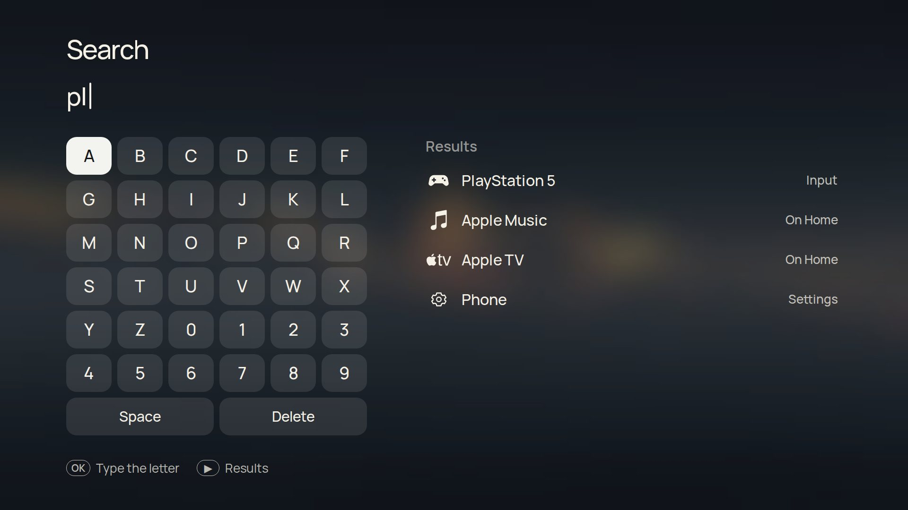
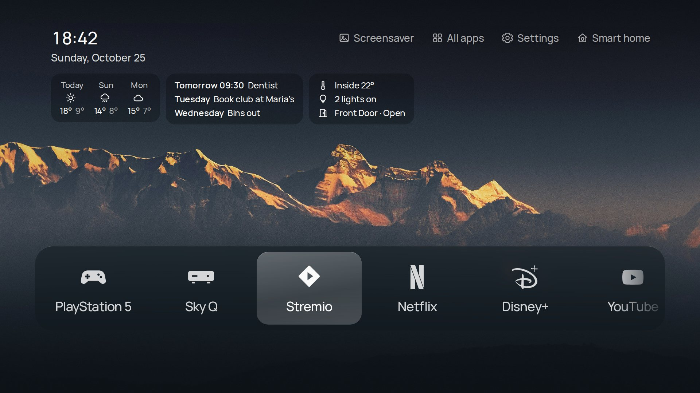
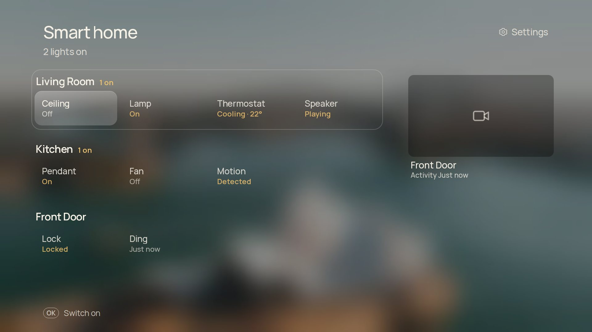
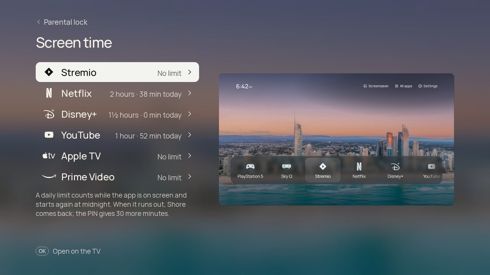
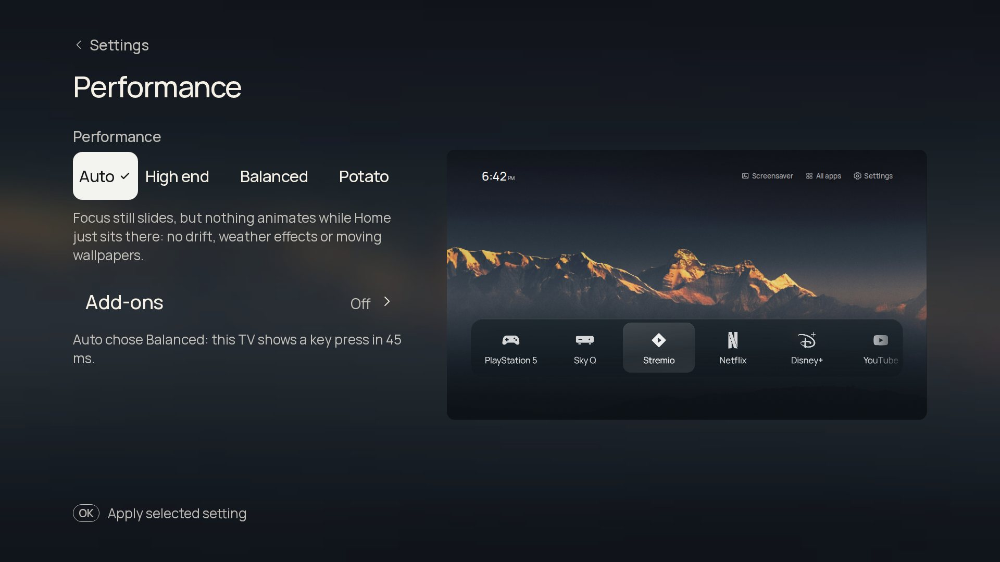

<div align="center">


# Shore

**A plainer home screen for Google TV.**<br>Your apps, your HDMI devices and a photo you chose, with the time, the weather and a headline in the corner.

[Website](https://taynotfound.github.io/shore/) · [Download](https://github.com/taynotfound/shore/releases/latest) · [Install](#install) · [Features](#features) · [Tested TVs](#tested-tvs) · [Build](#build-from-source) · [Discord](https://discord.gg/z6C4Mj9VPK)

[](https://ko-fi.com/taygotkofi) [](https://github.com/sponsors/taynotfound) [](https://discord.gg/z6C4Mj9VPK)


</div>

Shore is a free, open-source launcher for **Android TV and Google TV**. It shows your apps, the devices plugged into HDMI and a photo you chose, with the clock, the weather and a headline on top. While music plays it opens the song full screen, with synced lyrics. Hold Home and you are back in Google TV.

It is a fork of [Nathan Clark's CleanFrame](https://github.com/nthnclrk/CleanFrame), which was made for Samsung's The Frame. The interface is the original HTML/CSS app; a small Java shell runs it full screen and connects it to the TV. Shore is built and tested on a **TCL 55C6KS**, and people run it on [other TVs](#tested-tvs) too.

> [!NOTE]
> **Unofficial.** Not affiliated with TCL, Google, Samsung or any streaming service. Everything here is reversible, and each step says how.

## Install

You need a computer on the same Wi-Fi with [Android platform tools](https://developer.android.com/tools/releases/platform-tools) (`adb`), once. Shore installs next to Google TV and removes nothing.

1. **Turn on developer options.** On the TV, open *Settings › System › About* and press OK on **Android TV OS build** seven times, until "You are now a developer" appears. Use the main profile; kids profiles hide this.
2. **Turn on USB debugging** in *Settings › System › Developer options*.
3. **Connect.** Replace `<tv-ip>` with the address from *Settings › Network*, then press OK on "Allow debugging?" and tick *Always allow*:

   ```sh
   adb connect <tv-ip>:5555
   ```
4. **Install** the APK from the [latest release](https://github.com/taynotfound/shore/releases/latest), or [build it yourself](#build-from-source):

   ```sh
   adb install -r Shore.apk
   ```
5. **Point Home at Shore.** Turn on *Settings › System › Accessibility › Shore Home button*. On TCL sets, also [allow auto start](#tcl-tvs-allow-auto-start).

Open Shore once. The first time it offers a short setup, and *Settings › Google TV › Setup and health* lists each step with a tick when it works. After this you never need the computer again: Shore [updates itself](#updates).

<details>
<summary>Android 14 builds with "Wireless debugging"</summary>

Open *Wireless debugging › Pair device with pairing code*, then run `adb pair <ip>:<pair-port> <code>` and `adb connect <ip>:<port>`. The pairing port is different from the connect port.

</details>

## Features

| | What it does | More |
| --- | --- | --- |
| **Home** | Dock, List and Shelf layouts. Up to nine apps in the order you choose, recently used apps, your own icon for every app, Continue watching. | [Home screen](#home-screen) |
| **HDMI inputs** | A console or set-top box gets a tile when it is switched on, named over HDMI-CEC ("PlayStation 5", not "HDMI 1"). | [Inputs](#hdmi-inputs) |
| **Search** | Apps, inputs and Settings pages, with the remote's keyboard or typed on your phone. | [Search](#search) |
| **Pictures** | 15 bundled photos, online and animated wallpapers, your own photos from your phone, a different photo for morning, day, evening and night. | [Wallpapers](#wallpapers) |
| **Under the clock** | Weather with a three-day forecast, headlines, your next calendar event, what is playing. An optional Widgets row of small cards. | [Under the clock](#under-the-clock) |
| **Music view** | The cover, a progress bar you can seek, controls, and synced lyrics that light up word by word. Optional beat pulse. | [Music view](#music-view) |
| **When you're away** | Shore's own screensaver, night mode, and a sleep timer that switches the TV off. | [Away](#screensaver-night-and-sleep) |
| **Control** | Give any remote button a job. A parental lock with a PIN and daily screen time limits per app. | [Remote](#remote-buttons), [Lock](#parental-lock-and-screen-time) |
| **Phone companion** | A web app on your phone, served by the TV: photos, settings, apps, inputs, a keyboard, a problem report, backups. | [Phone companion](#phone-companion) |
| **Add-ons** | Optional and off until you switch them on: Home Assistant (rooms, cameras, doorbell), Pi-hole and AdGuard, weather effects, headlines, widgets. | [Add-ons](#add-ons) |
| **Performance** | *Auto*, *High end*, *Balanced* or *Potato*: Shore measures your TV and keeps what it can draw smoothly. | [Performance](#performance) |
| **Languages** | English, German, French, Spanish, Dutch, Polish, Ukrainian, Italian and Turkish, following the TV's language. | [Language](#language) |
| **Updates** | Shore checks the public releases, downloads the new APK and asks Android to install it. A *What's new* card follows. | [Updates](#updates) |

<table>
<tr>
<td width="33%"><br><sub><b>Search</b> finds apps, inputs and Settings.</sub></td>
<td width="33%"><br><sub><b>Widgets</b> under the clock.</sub></td>
<td width="33%"><br><sub><b>Music view</b> with synced lyrics.</sub></td>
</tr>
<tr>
<td><br><sub><b>Home Assistant</b> rooms and cameras.</sub></td>
<td><br><sub><b>Screen time</b> limits per app.</sub></td>
<td><br><sub><b>Performance</b>: Auto, High end, Balanced, Potato.</sub></td>
</tr>
</table>

<sub>The last six pictures are the interface in a desktop browser with invented data, at 1920×1080. The others in this file are the TV itself.</sub>

## Tested TVs

Shore is an ordinary Android TV app, so most Google TV and Android TV sets should work. These are confirmed by the maintainer or by people running it:

| TV | System | Chip, memory | Notes |
| --- | --- | --- | --- |
| TCL 55C6KS | Android TV 12 (Google TV) | MediaTek, 4K Mini LED | Reference TV: everything is built and checked here |
| TCL 65C7K | Google TV | | Reported working |
| CHiQ L32QM8G | Android 14 | | Reported working |
| Hisense A6N series ("SmartTV 4K", lushan-NF) | Android TV 12 (API 31) | MediaTek MT9676, 4× Cortex-A55 at 1.53 GHz (32-bit), Mali-G52, 2 GB RAM | Works with only ~360 MB free; the interface draws at 1080p and is scaled to 4K. Home Assistant add-on tested here. WebView Chrome 155 |

Running it on another TV? A [TV report](https://github.com/taynotfound/shore/issues/new?template=3-tv-report.yml) adds it to this list. On a slow set, see [Performance](#performance).

---

# Reference

[Set up](#set-up-and-update) · [Home](#home-screen) · [Wallpapers](#wallpapers) · [Under the clock](#under-the-clock) · [Music view](#music-view) · [Away](#screensaver-night-and-sleep) · [Control](#remote-buttons) · [Performance](#performance) · [Phone companion](#phone-companion) · [Add-ons](#add-ons) · [Top Shelf](#top-shelf) · [Build](#build-from-source) · [Credits](#credits-and-licences)

## Set up and update

### Make the Home button open Shore

Google TV always sends Home to its own launcher and ignores the "default home app" setting. Shore includes a small accessibility service that catches the Home key instead, the same approach launchers like Projectivy use. Turn it on yourself:

**Settings › System › Accessibility › Shore Home button › On**

- Press Home to open Shore.
- Hold Home for about a second to open the original Google TV Home. *Settings › Google TV › Google TV Home* in Shore does the same.
- If Google TV Home appears by itself, for example after leaving an app, Shore takes over. It won't do that if you opened Google TV Home on purpose.

The service only sees remote keys and which app is in front. It never reads screen content. Turn the switch off to undo.

#### TCL TVs: allow auto start

> [!IMPORTANT]
> After a restart, TCL's boot manager refuses to start accessibility services of apps without its *auto start* permission. The switch then still shows *Enable* on, but the service shows *Off* and no button works. Shore's *Remote buttons* page says so when this happens. Allow Shore to auto start in TCL's **TV Guard** (permission manager), then switch *Shore Home button* off and on once.

When something stops working (the Home button service after an update, notification access, a wallpaper source) or an update is waiting, a small dot appears on *Settings*. *Settings › Google TV › Setup and health* says what.

### Updates

After the first install you don't need a computer again. *Settings › Google TV › Shore updates* checks the public releases (automatically every few hours, or on demand), downloads the new APK, checks that it is Shore, newer and signed with the same key, and opens Android's installer. Android asks you to confirm, and the first time it asks you to allow Shore to install apps. Settings and photos stay.

Only release APKs update themselves: a copy you built yourself just tells you when a new version is out, so you can pull the latest source and rebuild it with your keys. After an update, Home shows *What's new* once: the release's headline and its first lines, read from that version's GitHub release (in English). They stay under *Shore updates* afterwards.

> [!NOTE]
> **Release APKs carry no API keys.** Each release is built from `main` (version `0.8.<commit count>`). Weather, NASA, Bing, Wikimedia and Picsum wallpapers, album art lookups and everything else work as they are. Unsplash, Pexels and Klipy wallpapers and Top Shelf recommendations need your own keys: [build from source](#build-from-source) with them in `android/local.properties`.

### Optional: switch off TCL's extras

[`debloat/packages.txt`](debloat/packages.txt) lists TCL and Google extras that are safe to switch off, such as Samba TV tracking, promo overlays, the store demo and Alexa, each with a comment. Edit the list, then:

```sh
TV=<tv-ip>:5555 debloat/debloat.sh disable   # switch them off (nothing is uninstalled)
TV=<tv-ip>:5555 debloat/debloat.sh status
TV=<tv-ip>:5555 debloat/debloat.sh restore   # switch them back on
```

Live TV, inputs, settings, the remote, casting, updates and Google TV itself are never on the list. A firmware update or factory reset may switch apps back on.

## Home screen


- Three layouts. *Dock* and *List* draw every app logo the same way: Shore's own logos in colour or in one colour, or the icons from an installed icon pack (for example one made for Projectivy Launcher). *Shelf* shows each app's own banner, with a [Top Shelf](#top-shelf) above it.
- Shore finds your installed apps. Pick up to nine for Home and put them in order, under *Settings › Apps on Home* or in the [phone companion](#phone-companion).
- *Recently used*: in Dock, up to three apps you opened lately but haven't put on Home follow Home's apps, after a thin line. Turn it off in *Settings › Home screen*.
- Your own icon for each app: hold OK on an app and choose *Icon*, or go to *Settings › Home screen › App icons › Per app*. Pick one of Shore's icons, the app's own icon or a one-colour version.
- Hold OK on an app on Home for *Open*, *Move*, *Remove*, *Icon* or *App info*. A normal press still opens the app; Move and Remove go through *Apps on Home*, so they can be undone.
- *Continue watching*: in Dock, a row under the apps with what you were watching in apps that share it with Android (Twitch, Apple TV and others); in Shelf, each app's own items come first in its Top Shelf row. Allow it when Android asks.
- While something plays, a ♪ *Music* button joins the top-right row and opens the [music view](#music-view). After a pause it stays for 10 minutes so you can resume. It needs Notification access, like Now playing.
- *Hide controls when idle* (Night page): after 1 or 5 minutes only the picture and clock stay.
- Animations pause outside Home, so menus stay snappy.


### HDMI inputs

Inputs come from Android's TV Input Framework. A device that is **plugged in and switched on** gets a tile; standby or unplugged devices are hidden. OK switches the TV to that input, and inputs you rename in the TV settings keep their name. Otherwise a tile uses the name the device announces over HDMI-CEC, such as *PlayStation 5* or *Apple TV*. CEC must be on in the TV settings (TCL calls it *T-Link*); without it the port name, such as *HDMI 1*, is shown.

Choose *Settings › Home screen › Inputs › First in Home* or *Own row*. When a device switches on while Home is showing (or the screensaver runs), Shore asks *PlayStation 5 is on · Switch / Stay*; OK switches to it, and the question goes away after 20 seconds. Turn this off with *Ask* in the same row. Inputs you never use can be hidden.

Each input gets an icon from its name: a controller for *PlayStation* or *Xbox*, a box for *Sky Q*, a disc for a Blu-ray player, a speaker bar for a soundbar, and so on; unknown devices keep the HDMI plug. To change either, hold OK on the tile (*Rename*, *Icon*) or open *Settings › Inputs* and pick the input. *Name* offers common devices, and the phone companion's *Apps* tab takes any name you type.

### Search

*All apps › Search*, or type a letter on a keyboard. Search finds your apps, your HDMI inputs and Settings pages (try "night", "lock" or "slow"), with a six-by-six letter grid for the remote. With a phone paired, the [phone companion's keyboard](#phone-companion) types into it, and Enter opens the first result.

### Language

Shore uses the TV's system language: German, French, Spanish, Dutch, Polish, Ukrainian, Italian and Turkish are built in, and anything else shows English. Change it in *Settings › System › Language* on the TV, then reopen Shore. Translations live in [`app/i18n/`](app/i18n/), one file per language keyed by the English text and loaded by [`app/i18n.js`](app/i18n.js); the phone companion keeps its own short list in `STR` in its `app.js`. In the browser preview, `?lang=de` picks a language.

### Settings


Shore's settings are two columns of short pages. **Look**: Wallpaper, Home screen, Apps on Home, Style (focus, material, accent, glass) and Text. **When you're away**: Night and Screensaver. **Clock and info**: Clock, Weather, Music and News. **Shore**: Inputs, Phone, Performance, Add-ons and Google TV (Home, TV settings, remote buttons, setup and updates). Up and Down move within a column, Left and Right cross to the other one. The phone companion lists the same groups.

Text: eight open-licence fonts, with text weight and app-name size. Clock: 12- or 24-hour, optional date, four sizes and weights.

## Wallpapers


- 15 bundled photographs with pre-rendered glass, plus online wallpapers from NASA, Bing, Wikimedia, Picsum and Unsplash.
- Animated wallpapers: bundled seamless loops, Pexels video loops and Klipy GIFs.
- Your own photos, GIFs and short videos from the [phone companion](#phone-companion).
- *Drift*: a slow Ken Burns zoom where the photo and its glass move together.
- *Rotation*: a new picture each time Home opens, every 5, 15 or 60 minutes, once a day, or *By time of day*: morning, day, evening and night each get their own photo. Pin one to each part, or leave it on *Automatic* for a darker photo in the evening and at night and a brighter one by day, different every day.
- Night mode dims everything on a timer or all the time; with *Calmer photos at night*, rotation sticks to dark photos while it is on (see [Away](#screensaver-night-and-sleep)).

### Online and animated sources

*Settings › Wallpaper › Sources.* Tick as many sources as you like: Shore wallpapers (the bundled gallery), My photos, NASA Astronomy Picture, NASA Image Library, Bing, Wikimedia, Picsum, Unsplash themes and animated loops. Only ticked sources rotate. The page says how many photos are in rotation (or which source couldn't be reached), OK on a row says *Add to rotation* or *Remove from rotation*, and the wallpaper gallery marks every photo that isn't in rotation.

**Favourites and hiding.** In the wallpaper gallery, press Right to reach **Favourite** and **Hide** under the preview; Up and Down keep stepping through photos, so you can sort several quickly. Favourites always rotate, whatever their source, and favourite online photos are kept on the TV even after their source moves on. Hidden photos never show up in rotation or the screensaver.

The TV downloads up to eight pictures or clips per source. On download it renders them once into the same files the bundled gallery uses: photo, thumbnail and four pre-blurred glass layers. Nothing is blurred live, so Home stays smooth. New wallpapers arrive every few hours, and rotation cycles through them. Animated wallpapers play as muted MP4 loops, with glass rendered from the first frame; Klipy GIFs are fetched as MP4s, which are much lighter than GIF files.

NASA, Bing, Wikimedia, Picsum and the bundled loops work without keys. Unsplash, Pexels and Klipy need free developer keys. Put them in `android/local.properties` (ignored by git), or pass them as environment variables when building:

```properties
unsplash.accessKey=...   # https://unsplash.com/developers
pexels.apiKey=...        # https://www.pexels.com/api/
klipy.apiKey=...         # https://partner.klipy.com/
```

> [!WARNING]
> Keys are compiled into your APK, so don't share an APK that contains them.

Credits for each picture appear in the wallpaper gallery, as the sources' terms ask.

<table>
<tr><th>Aurora</th><th>Dusk</th><th>Deep sea</th></tr>
<tr>
<td></td>
<td></td>
<td></td>
</tr>
</table>

<sub>Bundled animated loops. On the TV they play at 1080p behind the interface.</sub>

## Under the clock

*Settings › Weather, Music and News.*

- **Weather** shows the temperature and sky, such as *12 °C Cloudy*, next to the date. It comes from [Open-Meteo](https://open-meteo.com), which needs no key or account. The place is the city of the TV's time zone (*Europe/Berlin* gives Berlin), or the place you type in the [phone companion](#phone-companion). Choose **°C or °F** under *Temperature*. Shore refreshes the weather every 30 minutes, and it is off until you turn it on. Icons follow the sky and switch to night versions after sunset.
- **Headlines** (*Settings › News*, an [add-on](#add-ons)) show one news headline under the clock and on the screensaver, with its source, changing every 20 seconds. Choose the **source**: Google News top stories for the TV's language and country, a news outlet for the TV's language (for example tagesschau, DER SPIEGEL, ZEIT ONLINE and DW in German, ANSA and la Repubblica in Italian, BBC News Türkçe and DW Türkçe in Turkish, BBC News, The Guardian, NPR and Al Jazeera in English; BBC News is offered in every language), or **Your own feed**, any RSS or Atom feed you save under *News feed* in the [phone companion](#phone-companion). The TV fetches the feed at most every 30 minutes and keeps only titles, sources and times; nothing else is sent.
- **Calendar**: the next event from your calendar's iCal address (Google Calendar, iCloud, Outlook and others share one), set in the phone companion. Repeating events are understood. The TV fetches it at most every 15 minutes and keeps only the next event.
- **Now playing** shows a small moving level meter and *Title · Artist — App* while something plays in another app, for example Spotify in the background. Android only shares media sessions with apps that have notification access, so allow **Shore Now playing** under *Settings › Apps › Special app access › Notification access*; the Music page has a shortcut. Shore reads only the active media session and ignores notifications themselves. The level meter is decoration and does not follow the music.
- **Album art** (*Music*): while music with a cover plays, the cover becomes the background, softly blurred and dimmed, and the glass shows it through. It needs a Photo background and goes back to your wallpaper when the music stops. The blur is made once per track on the TV's CPU, not live in the page.
- **Sharper pictures** (same page, on by default): media apps often share only a small cover, which looks soft at TV size. Shore then looks up a wide artist picture on [TheAudioDB](https://www.theaudiodb.com) and, if none fits, a 1000-pixel cover from the [iTunes Search API](https://performance-partners.apple.com/search-api). Only the artist name (and title for iTunes) is sent, once per track; results are cached on the TV for 30 days. Turn it off to keep everything on the TV.
- **Weather effects** (an [add-on](#add-ons)) draw the current weather over the photo: rain, a light drizzle, snow, drifting fog, or a storm with the odd flash of lightning. Clear and cloudy skies leave the photo alone. They need Weather on and a Photo background, follow night dimming, and pause whenever Home is not on screen. The layers are pre-drawn and only slide, so the TV never redraws or blurs the photo for them.
- **Widgets** (*Settings › Clock › Widgets*, an [add-on](#add-ons)) add a row of small cards: today and the next two days' forecast (needs Weather), up to three events in the next three days (needs Calendar), and, with the Home Assistant add-on, the inside temperature, how many lights are on and any open door or window. Each card appears only when it has something to show. Not available with the Shelf layout. The forecast comes in the same Open-Meteo request as the current weather.


## Music view


Press ♪ *Music* on Home while something plays.

- The cover, title, artist and album, with the music app's blurred cover behind them. A new song replaces everything on its own.
- A progress bar with the time played and left. Up selects it; Left and Right jump 10 seconds when the app allows seeking.
- *Previous*, *Pause/Play*, *Next*, and a button that opens the music app.
- Synced lyrics from [LRCLIB](https://lrclib.net), free and without an account. Lines ripple into place like Apple Music's, the line being sung grows, and its words light up in turn: exactly where LRCLIB has word timing, otherwise spread over the line. Shore only shows lyrics whose title, artist and length match the version playing, so a different edit or a cover shows none rather than the wrong words. Only the artist, title, album and length are sent.
- Beat pulse (off by default): the beat pushes the background and the cover out a little. Shore learns where each song keeps its beat, from 808s and kicks to snares, claps and hi-hats, and starts learning again when the song changes. It uses Android's Visualizer on the TV's own sound output, never the microphone, but Android still asks to allow audio recording. Only the bass level is read, about 20 times a second, and only while the music view is open.
- *Up next*: the next three songs, when the music app shares its queue (not every app does; Spotify on Google TV doesn't).
- *Translate lyrics* (off by default): each synced line gets a translation into the TV's language underneath. The lyric text is sent to Google Translate; songs already in that language stay as they are.
- While a song plays, the music view keeps the screen on and the screensaver away, like a video.
- *Settings › Music › Music view* turns lyrics, word by word, translation, Up next and the beat pulse on or off.

The music view is built in, but its code is only fetched the first time it opens, so a TV that never plays music never loads it.

## Screensaver, night and sleep


### Screensaver

*Settings › Screensaver.* Shore has its own screensaver instead of the TV's: after 5, 10 (default) or 15 minutes without a button press it fades to a slow slideshow of your wallpapers (the sources in rotation, including My photos). Photos drift slowly, and every few slides it shows a mosaic of two or three photos at once. A large clock, the date, the weather and a headline sit on top. Turn on *Photo title* (*Screensaver › Arrangement and clock*) to see each photo's name and credit underneath. While music plays it adds a small card with the cover, title and artist; the album art never replaces the photos. The clock moves to another corner every few minutes so nothing sits on the same pixels for hours. Any button wakes Shore without doing anything else. *Start the screensaver now* is on the same page, and the **Screensaver** button on Home and the *Screensaver* remote-button action start it too.

The same page chooses when it starts, the photos (*Like Home*, which adds Shore's wallpapers when your rotation has only a few; *Everything*; or *Built-in*) and 15, 30 or 60 seconds per slide. *Arrangement and clock* chooses mixed, one photo or mosaics, switches the slow pan off, fixes or hides the clock, and hides the date and weather or the music card.

While Shore's screensaver is on and Shore is in front, Shore keeps the TV's own screensaver away. After four hours of screensaver it lets go, so the TV's usual sleep timer still turns the TV off. Choose *Off* to leave everything to the TV.

<details>
<summary>Use Shore as the screensaver everywhere (optional)</summary>

The APK also contains Shore as a system screensaver (`ShoreDream`), for when the TV goes idle inside another app. Google TV doesn't list third-party screensavers in its settings, so it can only be picked over ADB. Note the current value first so you can restore it:

```bash
adb shell settings get secure screensaver_components # likely com.google.android.apps.tv.dreamx/.service.Backdrop
adb shell settings put secure screensaver_components app.cleanframe.tv/.ShoreDream
```

To undo, put back the value from the first command.

</details>

<details>
<summary>Google TV hides Notification access</summary>

Some Google TV builds don't show the Notification access page. In that case you can allow it once from a computer on the same network, using ADB:

```bash
adb shell cmd notification allow_listener app.cleanframe.tv/app.cleanframe.tv.NowPlayingService
```

To undo, run the same command with `disallow_listener`.

</details>

### Night mode

*Settings › Night.* Night mode dims everything on a timer (21–07, 22–06, 23–07) or all the time, in three strengths. With *Calmer photos at night*, rotation sticks to dark photos while it is on, and a bright wallpaper gives way to a dark one when night begins.

### Sleep timer

*Settings › Night.* 30, 60, 90 or 120 minutes, then the TV switches off, even while another app is open. It needs the Shore Home button in Accessibility. You can also give it a [remote button](#remote-buttons): each press moves to the next step.

## Remote buttons

*Settings › Google TV › Remote buttons* (needs the accessibility service). Choose **Assign a button…**, press a button on the remote, then pick what it does:

- *Default*: what the TV normally does. This removes the assignment.
- *Shore Home*, *Do nothing*, *Screensaver* or *Sleep timer*.
- A connected HDMI input, or an app from your Home screen.

Assignments work everywhere, including inside other apps.

<details>
<summary>Limits</summary>

- Shore only sees buttons that reach Android's accessibility key filter. If the TV firmware handles a button first, the page says *No button arrived*.
- Navigation, OK, Back, Home, volume and power are never captured.
- Two buttons that send the same Android key code share one assignment.
- Not yet tested on the TCL RC833 remote itself.

</details>

## Parental lock and screen time

*Settings › Google TV › Parental lock.* Choose a four-digit PIN. It is asked before the apps you pick open, and, if you like, before Settings, Apps on Home and Quick actions. Enter it with the arrows and OK or with the number keys.


**Screen time** on the same page gives an app a daily limit (30 minutes to 3 hours). It counts while the app is on screen and starts again at midnight. When it runs out, Shore comes back with *Time's up*, and the PIN gives 30 more minutes. Both need the Home button service. The lock can be turned off again, which forgets the PIN.

## Performance


*Settings › Performance.* None of the four choices changes the look, your apps or any setting; they change what moves.

| Choice | What it does |
| --- | --- |
| **High end** | Keeps every animation and effect that is switched on. |
| **Balanced** | Keeps the focus slides, but stops everything that animates while Home just sits there: drift, weather effects, animated and GIF wallpapers, the screensaver's slow pan and zoom, the beat pulse. |
| **Potato** | Also removes every transition: focus moves at once, and the fades at the ends of the app list and Dock go. |
| **Auto** (default) | Starts from what the TV reports (a gigabyte of memory or less: Potato at most; two gigabytes or two cores or fewer: Balanced at most), then measures how long this TV takes to show key presses and settles on the tier it can draw smoothly. It steps up only with a clear margin and remembers the result. |

The page says what Auto chose and why ("Auto chose Balanced: this TV shows a key press in 45 ms."). What each feature and add-on costs, and how to measure it, is in [docs/performance.md](docs/performance.md). Those numbers come from a throttled desktop browser: they compare features with each other and are not a measurement of your TV, so judge by how the remote feels.

## Phone companion

*Settings › Phone › Phone companion.* Turn it on and the TV shows a QR code. Scan it with your phone's camera and tap **Install app**: Shore Companion lands on your home screen. Opening it takes you to a small web app served by the TV itself, styled like the launcher, with your current wallpaper behind glass cards.

- *Send to your TV*: pick photos (JPEG, PNG, WebP), GIFs or MP4 clips. Each photo first opens in a 16:9 frame, the TV's shape: drag to move it, pinch or use the slider to zoom, then **Send**. *Whole photo* sends it uncropped, *Skip* leaves it out. The crop is made on the phone at the photo's own resolution (up to 3840 px wide). They appear under **My photos**, a wallpaper source like the others. Glass is rendered once, rotation cycles through them, and GIFs and clips play animated. Choose *Settings › Phone › My photos* to use them.
- *My photos*: see what's stored and delete single photos or all of them. Shore keeps the newest 30, in its private storage on the TV.
- *Weather place*: the city for the weather under the clock.
- *Calendar*: your calendar's iCal address (a `webcal://` link works too). Saving it turns on the calendar line under the clock.
- *News feed*: an RSS or Atom address for the headlines. Saving one makes it the news source (*Your own feed* in *Settings › News*); clearing it goes back to Google News.
- *TV settings*: every setting from the TV's own Settings, grouped the same way, as buttons and switches. Changes apply on the TV at once, as if chosen with the remote, and *Start the screensaver now* is one tap. Shore must be open on the TV (in front or behind another app).
- *Apps*: reorder Home with the arrows, remove an app, or add one of the other installed apps. Name your HDMI inputs here too.
- *Add-ons*: the server address and password or token for [Home Assistant and Pi-hole or AdGuard](#add-ons), typed on the phone and kept on the TV.
- *Keyboard*: type on the phone instead of with the remote. While Shore is on screen the text goes to Shore's [Search](#search) (Enter opens the first result). In other apps it replaces the text of the focused field, such as a search box or a password, once you turn on the optional *Shore phone keyboard* under the TV's *Settings › Accessibility*. That service is separate from the Home button one and looks for the field only when the phone sends text. The text travels in the request body on your Wi-Fi, never in a URL.
- *Problem report* (TV settings tab): downloads a text file with Shore's crashes, Android's record of recent exits (including Shore not responding, on Android 11 and later) and errors from the page, plus the Shore, Android and WebView versions and the TV model. Attach it to a bug report. It stays on the TV until you download it and has no settings, addresses or passwords; *Clear* empties it. If the page's renderer stops, Shore notes it and reloads the page instead of closing.
- *Backup*: *Save backup* stores every TV setting (look, clock, Home apps and their order, wallpaper sources, screensaver) as a `.json` file on the phone. *Restore…* sends one back, after you confirm, to the same TV or another one running Shore. The TV checks the file like its own saved preferences, so a damaged or edited one can't break anything. Photos stay on the TV and are not part of the backup.
- *Installing*: the QR code opens [taynotfound.github.io/shore/app](https://taynotfound.github.io/shore/app/), a tiny installable page (HTTPS, manifest, offline cache). It remembers your TV and opens it whenever you start the app. If your browser shows no install button, use its menu: *Install app* or *Add to Home screen*. On iPhone: *Share › Add to Home Screen*.

**Privacy and limits**

- Nothing goes through the internet. Phone and TV must be on the same Wi-Fi, and the companion only runs while it's switched on.
- The QR code carries a random pairing key, which the phone keeps. Without it the TV answers nothing but the page itself. *Forget paired phones* makes a new key, and every phone has to scan again.
- Why two pages: browsers only install HTTPS sites, and a TV can't get a trusted certificate on a home network. So the installable part lives on the website, and the TV keeps serving the real page over `http://` on your Wi-Fi. The TV address and pairing key travel after the `#` in the link, which browsers never send to the website, and stay on your phone. The TV also shows its address for use without internet.
- If the TV's IP address changes, scan the code again. A DHCP reservation in your router avoids that.
- Forks: change `Companion.PAIR_URL` to your own GitHub Pages address.

## Add-ons

*Settings › Add-ons.* Optional features. Each has one switch, off by default, and a line saying what it does and what it costs a slow TV (*Light*, *Some cost* or *Heavy*). While an add-on is off its code is not even loaded; switching it on fetches it after Home has painted. Once on, its own settings page appears below the switches.

| Add-on | What it adds | Available on |
| --- | --- | --- |
| **Home Assistant** | Rooms, lights, switches, thermostats and cameras on a *Smart home* page, the inside temperature under the clock, and your door camera when the doorbell rings | Android TV |
| **Pi-hole and AdGuard** | Today's blocked share under the clock, and a pause for 5, 30 or 60 minutes | Android TV |
| **Weather effects** | Rain, snow, fog and storms over the photo | Everywhere |
| **Headlines** | One news headline under the clock | Android TV |
| **Widgets** | A row of small cards under the clock | Everywhere |

### Home Assistant

The Home Assistant add-on was made by [mozthewah](https://github.com/mozthewah).


- Type the server address and a long-lived access token in the [phone companion](#phone-companion). The TV never shows or stores the token in its preferences.
- A *Smart home* control joins Home's top row. Rooms (Home Assistant's areas) are rows of chips: the device name and its state. OK switches a light, switch or fan and locks or unlocks a lock. Hold OK on a dimmable light for brightness and colour; OK on a thermostat opens its target temperature and modes. Cameras sit in a column on the right, and OK opens a live view.
- *Settings › Add-ons › Home Assistant* picks the rooms to show and disconnects. Devices hidden in Home Assistant stay hidden.
- **Doorbell** (*Home Assistant › Doorbell*): choose what rings and which camera to show. When it rings while Shore is in front, even on the screensaver, the camera's live view opens for up to two minutes. While another app is in front, Android shows a short note instead.

### Pi-hole and AdGuard

Type the server address and password in the phone companion. The line under the clock gains today's share of blocked queries ("12.4% blocked today"), or "Blocking paused · 4 min" during a pause. *Settings › Add-ons › Pi-hole and AdGuard* shows the connection, switches blocking on or pauses it for 5, 30 or 60 minutes (the server ends the pause by itself) and disconnects. The password never reaches the page.

## Top Shelf

*Settings › Home screen › Layout › Shelf.* As on Apple TV, the focused app fills the screen with what is trending there. **Down** opens a row of recommendations. **OK** opens an item directly in YouTube, Twitch, ZDF or ARTE, and opens the app itself for the others. **Up** or **Back** returns to the apps.

Google TV doesn't share its recommendations with other launchers, so Shore reads public catalogues about once an hour, over HTTPS only:

| Apps | Source | Key |
| --- | --- | --- |
| ARD Mediathek, ZDF, ARTE | Their own public catalogues | None |
| Netflix, Disney+, Prime Video, Joyn, waipu.tv, Apple TV | [TMDB](https://www.themoviedb.org) watch providers for Germany | `tmdb.token` |
| YouTube | YouTube Data API v3 | `youtube.apiKey` |
| Twitch | Twitch Helix API | `twitch.clientId`, `twitch.clientSecret` |

<details>
<summary>Getting the Twitch keys (no login or user token needed)</summary>

Shore asks Twitch for an **app access token** by itself (the *client credentials* flow), so you never sign in or paste a token. You need two values from your own Twitch application:

1. Open the [Twitch developer console](https://dev.twitch.tv/console/apps) and choose **Register Your Application**. Turn on two-factor authentication first if Twitch asks for it.
2. **Name**: anything unique, for example `Shore-TV-yourname`. **OAuth Redirect URLs**: `http://localhost`. Twitch requires one, but Shore never uses it. **Category**: *Application Integration*. **Client type**: *Confidential*.
3. Open the application with **Manage**. Copy the **Client ID**, then choose **New Secret** and copy the **Client Secret**. Twitch shows it only once.
4. Add both to `android/local.properties` and rebuild:

   ```properties
   twitch.clientId=your-client-id
   twitch.clientSecret=your-client-secret
   ```

To check the pair before building, ask Twitch for a token yourself. A JSON reply with `access_token` means the keys work:

```bash
curl -X POST "https://id.twitch.tv/oauth2/token" -d "client_id=YOUR_ID" -d "client_secret=YOUR_SECRET" -d "grant_type=client_credentials"
```

Authorize links (`https://id.twitch.tv/oauth2/authorize?…`) and token generator websites create *user* tokens, which Shore doesn't use. Never paste a user token anywhere: it can act as your account. If you made one, revoke it under twitch.tv › *Settings › Connections*.

</details>

Apps without recommendations show their own banner, softly blurred. Keys go in `android/local.properties`, or the environment variables `TMDB_TOKEN`, `YOUTUBE_API_KEY`, `TWITCH_CLIENT_ID` and `TWITCH_CLIENT_SECRET` (also used as GitHub Actions secrets).

## Build from source

You need JDK 17 and the Android SDK (platform 35), or Android Studio.

```sh
git clone https://github.com/taynotfound/shore.git
cd shore
echo "sdk.dir=$HOME/Android/Sdk" > android/local.properties
gradle -p android assembleRelease
adb install -r android/app/build/outputs/apk/release/app-release.apk
```

Without signing secrets, the APK is signed with your computer's debug key. Keep using the same key so updates install in place and keep your settings. A self-built APK and a release APK are signed differently, so switching between them means uninstalling first.

GitHub Actions ([`android.yml`](.github/workflows/android.yml)) builds a keyless APK from `main` and publishes it as a release when it is started by hand (*Run workflow*, or `gh workflow run android.yml`). It needs the signing key as repository secrets (`KEYSTORE_BASE64`, `KEYSTORE_PASSWORD`, `KEY_ALIAS`, `KEY_PASSWORD`) so every release can update the last one; `SHORE_PUBLIC_BUILD=1` makes sure no key from `local.properties` or the environment gets in.

The interface also runs in a desktop browser for design work: `npm ci && npm run dev:public`, then open [localhost:4795/home/](http://localhost:4795/home/). Run `npm run check` and `npm run check:browser` after changing `app/`, and read [CONTRIBUTING.md](CONTRIBUTING.md) before opening a pull request.

| Path | What it is |
| --- | --- |
| `app/` | The Shore interface, shared with the Samsung version |
| `app/device-android.js` | Android adapter: apps, inputs, wallpapers, remote buttons |
| `app/addons/` | Add-ons, fetched only when switched on |
| `app/i18n.js`, `app/i18n/` | Translations |
| `android/` | Java shell: WebView, app and input bridge, Home button service, wallpaper and Top Shelf downloaders |
| `site/` | The [website](https://taynotfound.github.io/shore/) and the installable phone companion page |
| `debloat/` | Optional, reversible debloat list and script |
| `docs/android-tv.md` | Port notes. [`docs/upstream-README.md`](docs/upstream-README.md) is the original Samsung README |

**Brand.** The half sun over three lines in ivory `#e3e6dc`, on a deep blue-grey gradient (`#20303a` to `#0f161a`) with a warm accent `#f2c58b`, set in Manrope. The same mark is the TV icon, the launcher banner, the website and the phone companion. [`docs/brand/`](docs/brand/) holds the animated banner (SVG, GIF, MP4), the logo and mark, and ready-made ads (1200×628 and 1080×1080, as PNG and MP4). `python3 scripts/brand/make_brand.py` rebuilds them from the screenshots in `site/shots/` (needs Node with Playwright, ffmpeg and Pillow).

## Support

Questions, bugs or a TV to report: [Discord](https://discord.gg/z6C4Mj9VPK), usually the fastest way to reach me. Shore is free. If you'd like to support it: [Ko-fi](https://ko-fi.com/taygotkofi) · [GitHub Sponsors](https://github.com/sponsors/taynotfound)

## Credits and licences

- CleanFrame by Nathan Clark, MIT. This fork keeps the original [licence](LICENSE) and [third-party notices](THIRD_PARTY_NOTICES.md).
- Android TV port and TCL additions: Shore contributors, MIT.
- Home Assistant add-on: [mozthewah](https://github.com/mozthewah).
- App logos: [Simple Icons](https://simpleicons.org) (CC0) and public-domain wordmarks from Wikimedia Commons; see `app/assets/icons/SOURCES.json`. Trademarks belong to their owners.
- Fonts: SIL Open Font License; see `app/assets/fonts/`.
- Online wallpapers belong to their authors and are shown under each provider's terms: [NASA APOD](https://apod.nasa.gov), [Bing](https://www.bing.com), [Wikimedia Commons](https://commons.wikimedia.org), [Lorem Picsum](https://picsum.photos), [Unsplash](https://unsplash.com), [Pexels](https://www.pexels.com) and [KLIPY](https://klipy.com) ("Powered by KLIPY").
- The bundled animated loops were generated for this project.
- Weather data by [Open-Meteo](https://open-meteo.com) (CC BY 4.0). QR codes are generated with [ZXing](https://github.com/zxing/zxing) (Apache 2.0). Synced lyrics from [LRCLIB](https://lrclib.net).
- Shore name, icon and website: this fork. Shore is not affiliated with the original CleanFrame project.
- Top Shelf: this product uses the TMDB API but is not endorsed or certified by TMDB. Recommendations and images come from [TMDB](https://www.themoviedb.org), [ARD Mediathek](https://www.ardmediathek.de), [ZDF](https://www.zdf.de), [ARTE](https://www.arte.tv), [YouTube](https://www.youtube.com) and [Twitch](https://www.twitch.tv) under their terms. Titles and artwork belong to their owners.
